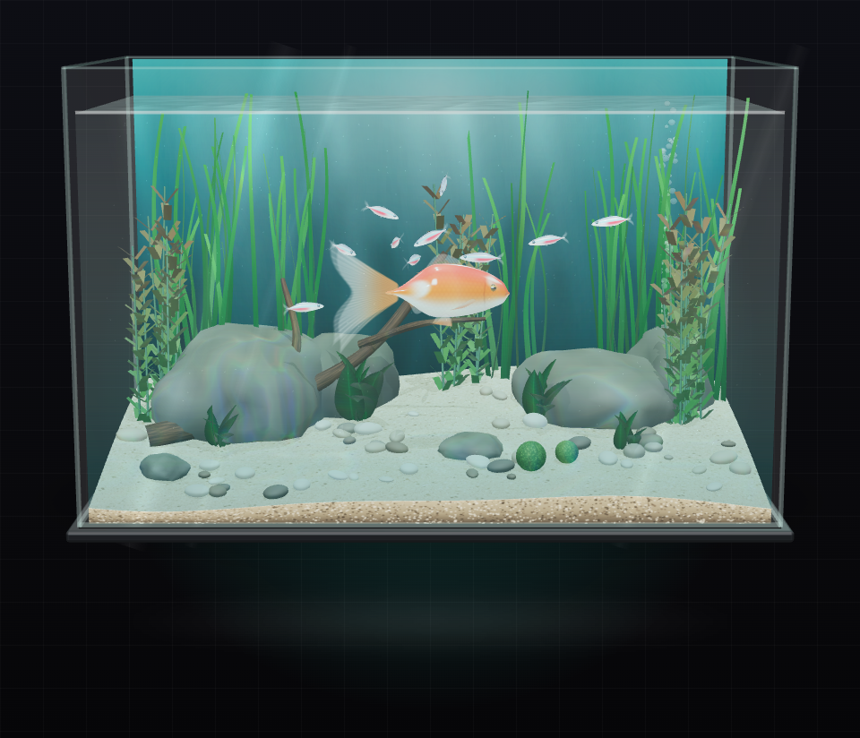
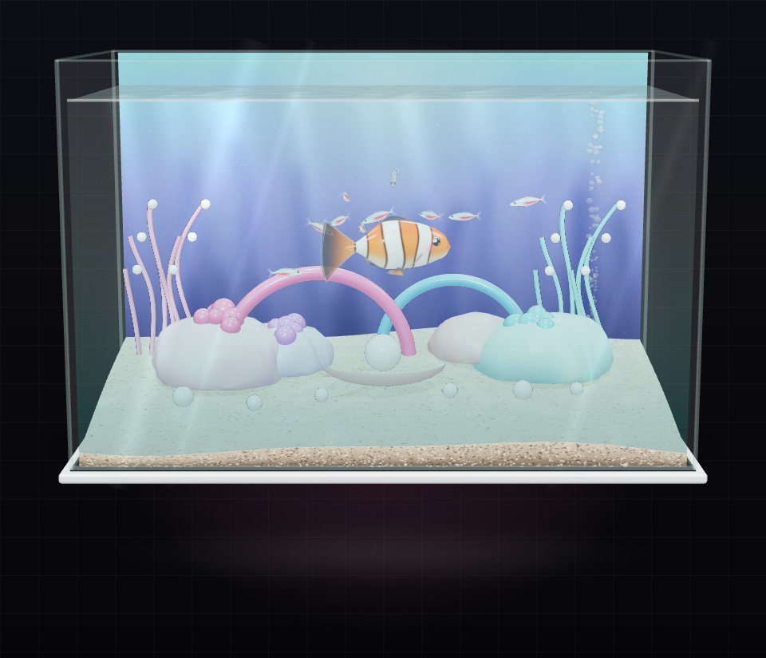
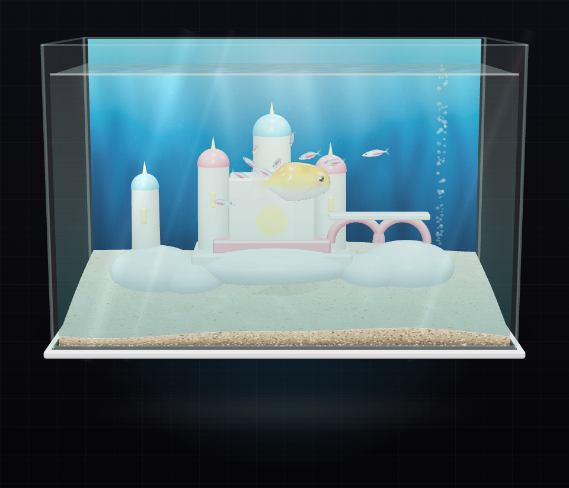
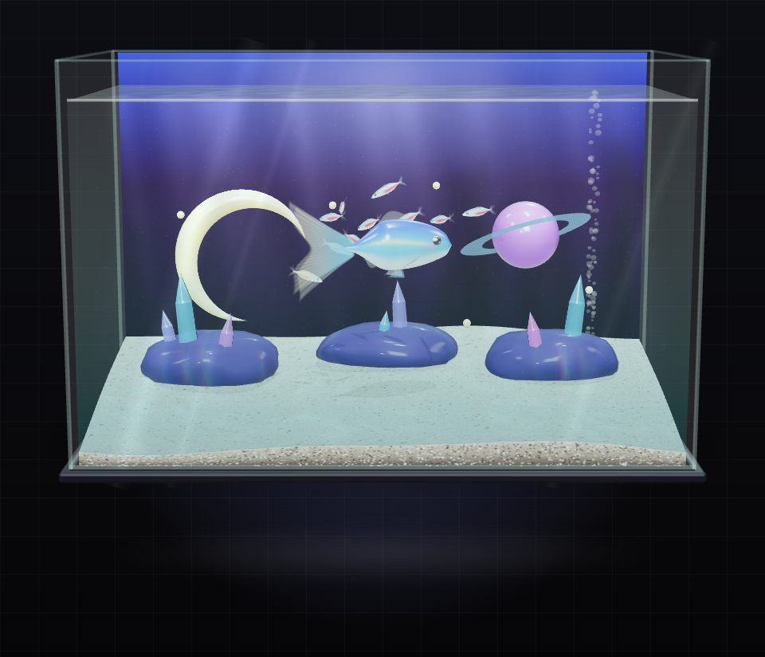
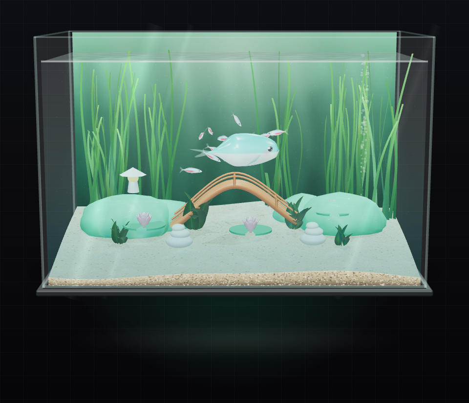
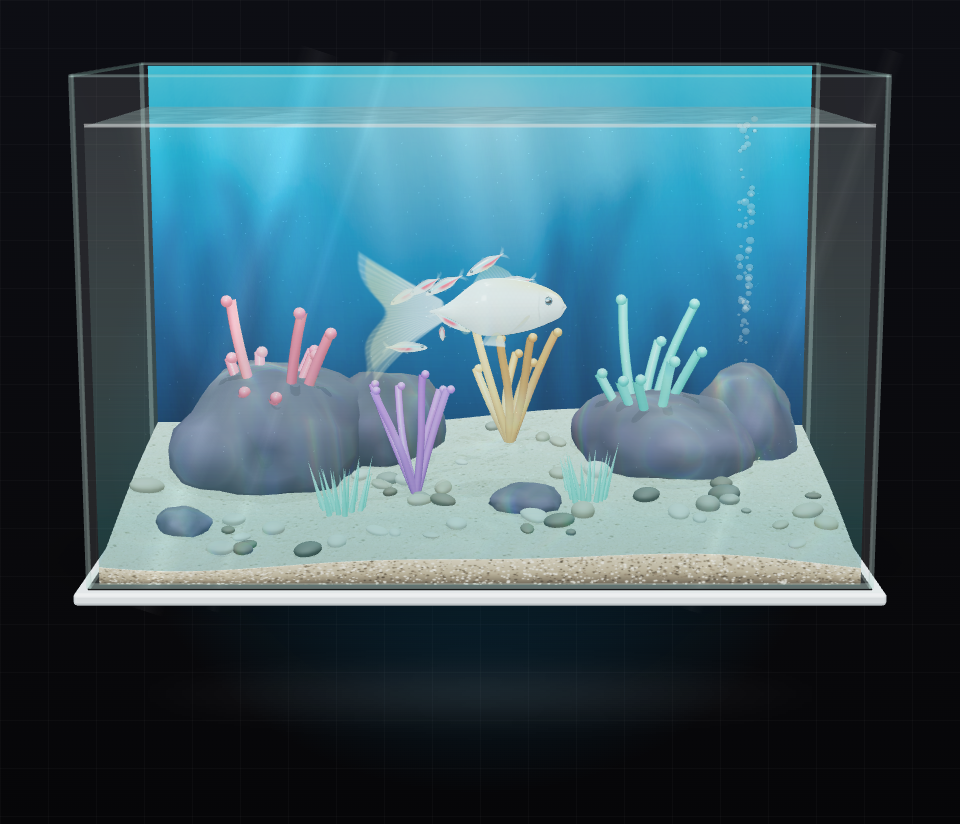

 

# DeskOasis · 桌面生态

**把一座会呼吸的无边框 3D 微景观鱼缸，安静摆在你的电脑桌面上**

 

### [国内高速直连下载（官网推荐）](https://oasis.goodtools.top) &nbsp;·&nbsp; [GitHub Releases 下载](https://github.com/happybear1015/desk-oasis/releases/latest)

首次安装如遇 Windows SmartScreen 提示，点击「更多信息 → 仍要运行」即可 · 零广告零捆绑

 

 

[8 套 3D 微景观](#8-套-3d-微景观鱼缸) &nbsp;·&nbsp;
[11 款精雕主鱼](#11-款精雕主鱼图鉴) &nbsp;·&nbsp;
[桌面漫游与壁纸屏保](#三种桌面形态) &nbsp;·&nbsp;
[好友串门与手机伴侣](#好友串门与手机伴侣)

 

---

## 设计与体验亮点

- **超白无框玻璃与点击穿透**：无标题栏、不占任务栏，透明区域直接穿透点击背后的编辑器或文档；支持光线亮度与窗口透明度无级滑块调节，按 `Ctrl + Alt + M` 一键隐身。
- **潮玩微景 + 自然水景双系列**：内置 8 套 3D 立体微景观与 11 款高细分曲面丝绸鱼鳍主鱼（**原生溪流**、**幻彩珍珠礁**、**丹霞琉金**、**珊瑚小丑鱼**永久免费内置）。
- **一缸一主鱼代表你自己**：平时鱼缸内由 1 条主鱼与伴游灯鱼群组成；去好友家串门或放出来逛桌面时，均由你的专属主鱼实时同步出镜。
- **极简原生三级右键菜单**：投喂、擦缸、切换造景鱼皮、好友串门、手机扫码与个人中心全部就地展开，零弹窗打扰。

---

## 8 套 3D 微景观鱼缸

### 潮玩艺术微景系列（4 套）

<table>
  <tr>
    <td align="center" width="50%">
       
      <b>幻彩珍珠礁</b> · <code>免费内置</code> 
      柔粉珊瑚礁丘 · 珠光扇贝与海珍珠 · 幻彩琉璃拱桥
    </td>
    <td align="center" width="50%">
       
      <b>纪念碑云城</b> · <code>单品 / PRO</code> 
      澄澈天青水光 · 象牙陶粉圣殿穹顶 · 连廊高架水桥
    </td>
  </tr>
  <tr>
    <td align="center" width="50%">
       
      <b>极光星环</b> · <code>单品 / PRO</code> 
      深空靛紫流光 · 弦月与双环行星 · 透光极光晶柱
    </td>
    <td align="center" width="50%">
       
      <b>京都苔庭</b> · <code>单品 / PRO</code> 
      清透抹茶苔山 · 红杉太鼓拱桥 · 雪见灯笼与浮水睡莲
    </td>
  </tr>
</table>

### 自然生态水景系列（4 套）

<table>
  <tr>
    <td align="center" width="50%">
       
      <b>原生溪流</b> · <code>免费内置</code> 
      清透山涧溪水 · 青灰原石与苍劲沉木 · 摇曳苦草丛
    </td>
    <td align="center" width="50%">
       
      <b>禅意枯山</b> · <code>单品 / PRO</code> 
      冷冽山影水色 · 苍翠修竹与青苔石灯笼 · 枯山意境
    </td>
  </tr>
  <tr>
    <td align="center" width="50%">
       
      <b>深海珊瑚</b> · <code>单品 / PRO</code> 
      深海蔚蓝丁达尔光束 · 鹿角珊瑚礁群 · 荧光摇曳海葵
    </td>
    <td align="center" width="50%">
       
      <b>落樱浅溪</b> · <code>单品 / PRO</code> 
      温润春溪水色 · 盛放水下樱枝 · 漫天纷飞花瓣
    </td>
  </tr>
</table>

---

## 11 款精雕主鱼图鉴

右键 **「造景与鱼皮 → 主鱼皮肤」** 即可免费实机试穿 15 秒或一键换装：

| 系列 | 主鱼名称 | 视觉特征 | 获取方式 |
| :--- | :--- | :--- | :--- |
| **潮玩造型** | **珊瑚小丑鱼** | 暖橘珊瑚色配雪白纹带，圆润灵动 | **免费内置** |
| **潮玩造型** | **奶油河豚** / **桃粉琉璃鱼** / **星海蓝灵** / **薄荷幼鲸** / **暮紫星羽** | 柔焦腮红、水平鲸尾、流光纱尾等高辨识度造型 | 单买 / PRO 全解锁 |
| **自然锦鳞** | **丹霞琉金** | 朱砂红与素白渐变，飘逸双叶长纱尾 | **免费内置** |
| **自然锦鳞** | **昭和三色锦鲤** / **月光蝶尾** / **黑金兰寿** / **绯樱透明鳞** | 丝绒墨金、冰透蝶翼、樱粉透明鳞片 | 单买 / PRO 全解锁 |

---

## 三种桌面形态

1. **桌面漫游（拖到边缘放鱼逛屏幕）**  
   将鱼缸拖到屏幕边缘松手，主鱼即刻游入全屏桌面自由巡游；支持 `1/16` 至 `1/2` 屏宽无级调节，轻点鱼身即可收回鱼缸（每日免费体验 10 分钟，支持单项买断或 PRO 不限时）。
2. **桌面动态壁纸**  
   将 3D 水景嵌入桌面图标底层常驻运行，不遮挡任何桌面文件与快捷方式。
3. **无边巨幕屏保**  
   全屏沉浸式 3D 水景，支持键鼠闲置 5 分钟自动开启，按 `Esc` 或移动鼠标即刻恢复工作。

  

---

## 好友串门与手机伴侣

- **跨桌面实时串门**：在 `右键 → 鱼友串门` 互换好友码。无论对方开着鱼缸还是正在桌面漫游，你的主鱼都能实时游过去同框陪伴，并支持「看缸 / 同屏看」与 20 字阅后即消水泡互动。
- **局域网手机伴侣**：在 `右键 → 手机伴侣` 扫码即连（免装 App），支持手机画中画悬浮同款 3D 鱼缸、远程喂鱼擦缸与纯本地私密计时器。

---

## 版本与权益

支持按需单项解锁，或在 **「个人中心 → 我的等级」** 一口价升级 PRO 终身通行证（已购单项自动抵扣差价）：

| 版本方案 | 包含权益 |
| :--- | :--- |
| **基础版（永久免费）** | 原生溪流 + 幻彩珍珠礁 + 丹霞琉金 + 珊瑚小丑鱼 + 桌面漫游（每日 10 分钟）+ 鱼友串门 + 手机伴侣 |
| **PRO 终身通行证** | 全部 8 套 3D 造景 + 全部 11 款主鱼皮肤 + 桌面漫游不限时 + 动态壁纸与巨幕屏保 |
| **单品按需解锁** | 任选单套造景 / 单款主鱼皮肤 / 桌面漫游不限时 / 壁纸屏保 |

---

## 快捷操作

| 操作 | 说明 |
| :--- | :--- |
| **左键拖拽鱼缸** | 任意摆放位置；拖至屏幕边缘松手进入桌面漫游 |
| **左键轻点** | 敲击玻璃唤鱼 / 点击好友鱼发水泡 / 漫游时点主鱼变回鱼缸 |
| **Ctrl + 滚轮** | 快速缩放鱼缸尺寸 |
| **右键鱼缸 / 托盘图标** | 展开三级快捷菜单（光线亮度、透明度、漫游鱼大小、造景鱼皮） |
| **`Ctrl + Alt + M`** | 一键隐藏 / 唤出鱼缸 |
| **`Ctrl + Alt + W`** | 快速退出桌面动态壁纸 |

---

  由北京创节软优科技有限公司研发运营 · <a href="https://oasis.goodtools.top">oasis.goodtools.top</a> · 如果喜欢这座桌边微景观，欢迎点亮右上角 <b>Star</b> 支持

