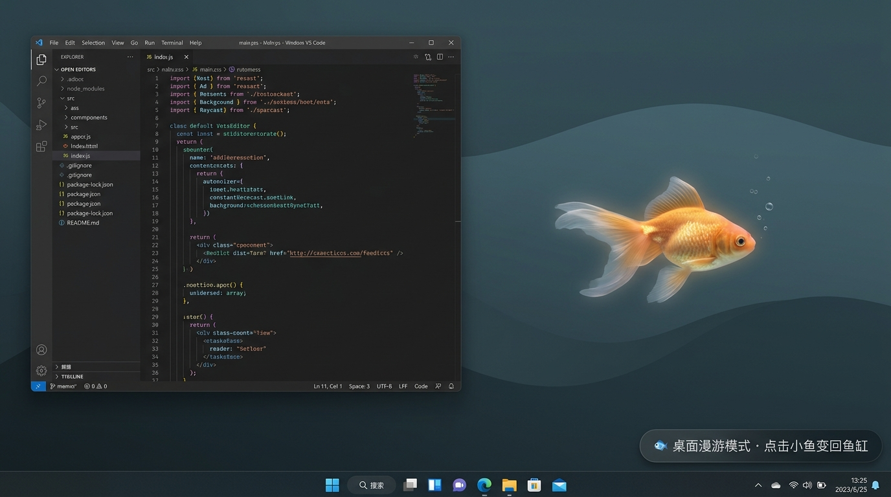
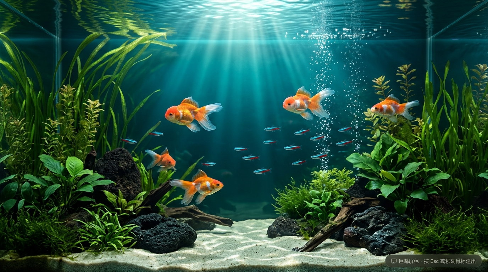
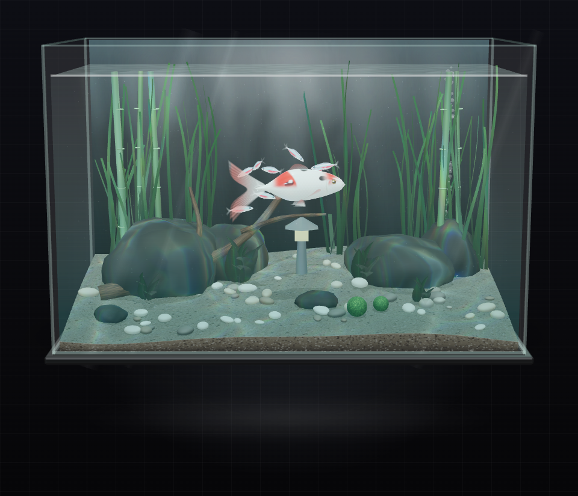
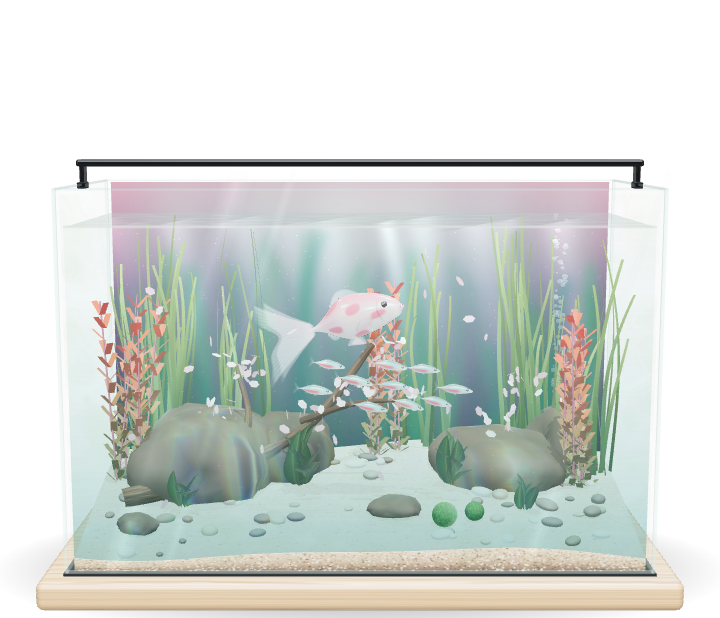

 

# DeskOasis · 桌面生态

**把一座会呼吸的 3D 微景观鱼缸，静静摆在你的电脑桌面上**

 

### [⚡ 国内高速直连下载（官网推荐，不卡顿）](https://oasis.goodtools.top) &nbsp;|&nbsp; [⬇ GitHub Releases 下载](https://github.com/happybear1015/desk-oasis/releases/latest)

首次安装如遇 Windows 蓝框提示，点「更多信息 → 仍要运行」即可 · 零广告零捆绑

 

 

[桌面形态](#三种桌面形态) &nbsp;·&nbsp;
[8 套造景与 11 款鱼皮](#8-套-3d-生态造景写实--高清卡通) &nbsp;·&nbsp;
[鱼友串门](#鱼友串门与水泡聊天) &nbsp;·&nbsp;
[手机伴侣](#手机伴侣)

 

---

## 产品亮点

- **无边框不挡操作**：无标题栏、不占任务栏，透明处可直接点击背后窗口；按 `Ctrl + Alt + M` 一键隐藏。
- **写实 + 高清卡通双系列**：4 套写实生态缸 + 4 套高清卡通缸，11 款精致主鱼皮肤（红白琉金与尼莫小丑鱼免费送）。
- **一缸一主鱼**：平时缸里只有 **1 条大鱼（你自己）** 和伴游小灯鱼；去好友家串门时，也是你的大鱼游过去。
- **清爽右键菜单**：喂鱼、擦缸、换造景/鱼皮、串门、手机扫码、个人中心就地展开，光线亮度与鱼身大小全部滑块可调。

---

## 三种桌面形态

### 1. 桌面漫游（小鱼出来逛屏幕）

把鱼缸拖到屏幕边缘松手，小鱼就会直接游到桌面上自由逛街；支持拖动与调整大小（1/16～1/2 屏宽），点一下小鱼变回鱼缸（每日免费体验 10 分钟，单买或 PRO 不限时）。

  

 

### 2. 动态壁纸 & 巨幕屏保

<table>
  <tr>
    <td align="center" width="50%">
       
      <b>桌面动态壁纸</b> 
      铺在桌面图标后方，不挡任何图标，返回桌面始终常驻
    </td>
    <td align="center" width="50%">
       
      <b>巨幕屏保</b> 
      全屏无边水景，支持闲置 5 分钟自动开启，按 <code>Esc</code> 或移鼠标退出
    </td>
  </tr>
</table>

---

## 8 套 3D 生态造景（写实 + 高清卡通）

**写实微景观系列**：🌿 原生溪流（免费）、🪨 禅意枯山、🪸 珊瑚深海、🌸 樱花古风。  
**高清卡通系列**：🍭 糖果童话缸（免费）、🏰 梦幻城堡缸、🌌 星梦极光缸、🍵 治愈森系缸。

<table>
  <tr>
    <td align="center" width="50%">
       
      <b>🌿 原生溪流</b> · <code>免费</code> 
      青绿溪水 · 灰石沉木 · 胡桃木底座
    </td>
    <td align="center" width="50%">
       
      <b>🪨 禅意枯山</b> · <code>PRO</code> 
      山影水景 · 翠竹石灯笼 · 哑光黑檀底座
    </td>
  </tr>
  <tr>
    <td align="center" width="50%">
       
      <b>🪸 珊瑚深海</b> · <code>PRO</code> 
      深海光束 · 鹿角珊瑚与海葵 · 烤漆白底座
    </td>
    <td align="center" width="50%">
       
      <b>🌸 樱花古风</b> · <code>PRO</code> 
      暖粉霞光 · 落樱花枝与花瓣 · 浅原木底座
    </td>
  </tr>
</table>

### 11 款主鱼皮肤（6 款高清卡通 + 5 款写实）

右键 **「造景与鱼皮 → 主鱼皮肤」** 可查看高清图案、免费试穿 15 秒或一键换装：

| 系列 | 主鱼皮肤 | 获取方式 |
| :--- | :--- | :--- |
| **高清卡通** | **🧡 尼莫小丑鱼** | **免费内置** |
| **高清卡通** | **💛 奶黄河豚团子** / **🩷 草莓泡泡鱼** / **💙 星空蓝胖鱼** / **🩵 薄荷小蓝鲸** / **💜 软萌紫猫鱼** | 单买 / PRO 全解锁 |
| **写实经典** | **🐟 红白琉金** | **免费内置** |
| **写实经典** | **🎏 大正三色锦鲤** / **🦋 月光龙睛蝶尾** / **🖤 墨玉麒麟兰寿** / **🌸 樱花透明鳞** | 单买 / PRO 全解锁 |

---

## 鱼友串门与水泡聊天

- **跨桌面串门**：在 `右键 → 鱼友串门` 互换 ID 添加好友。对方开鱼缸时，你的主鱼会游进对方鱼缸；对方在桌面逛街时，你的主鱼也会一起在对方桌面上自由逛。
- **实时观光**：串门时点「看缸 / 同屏看」，可实时查看对方桌面或鱼缸画面。
- **水泡消息**：点好友大鱼即可发送 20 字内水泡消息、戳一戳、帮忙喂鱼；消息阅后即消，不留记录。

---

## 手机伴侣

右键选择 **「手机伴侣」**，同一 Wi-Fi 下手机扫码即连，免装 App：

- 手机同步查看 3D 鱼缸，支持画中画悬浮窗
- 远程喂鱼、擦玻璃、孵化鱼卵
- 手机端计时与小工具仅存手机本地，不上传、不显示在电脑屏幕

---

## 版本与权益

支持按需单买，或到 **「个人中心 → 我的等级」** 一口价 PRO 终身全解锁（已单买项升级 PRO 时自动抵扣差价）：

| 方案 | 包含内容 |
| :--- | :--- |
| **基础版（永久免费）** | 原生溪流 + 糖果童话缸 + 红白琉金 + 尼莫小丑鱼 + 桌面漫游(每日10分钟) + 鱼友串门 + 手机伴侣 |
| **💎 PRO 终身全解锁** | 全部 8 套造景 + 全部 11 款主鱼皮肤 + 桌面漫游不限时 + 动态壁纸与巨幕屏保 |
| **单品解锁** | 任选单套造景 / 单款鱼皮 / 漫游不限时 / 壁纸屏保 |

---

## 常用操作

| 操作 | 效果 |
| :--- | :--- |
| **左键拖动鱼缸** | 自由摆放；拖到屏幕边缘进入桌面漫游 |
| **左键单击** | 敲玻璃 / 点好友鱼发水泡 / 漫游时点主鱼变回鱼缸 |
| **Ctrl + 滚轮** | 缩放鱼缸或漫游鱼大小 |
| **右键鱼缸 / 托盘** | 打开快捷菜单（调光线亮度、透明度、换造景鱼皮） |
| **`Ctrl + Alt + M`** | 一键隐藏 / 恢复鱼缸 |
| **`Ctrl + Alt + W`** | 退出动态壁纸 |

---

  如果这座桌边小鱼缸陪伴了你的日常，欢迎点亮右上角的 <b>⭐ Star</b> 支持！

