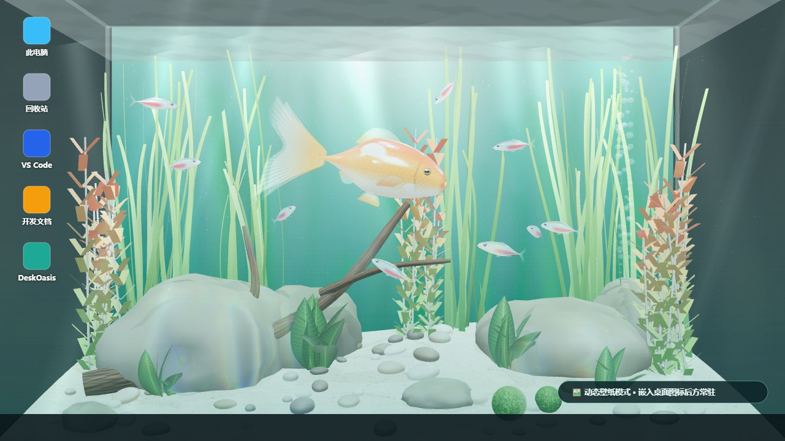

 

# DeskOasis · 桌面生态

**把一座会呼吸的 3D 微景观鱼缸，静静摆在你的电脑桌面上**

[-0078D6?style=flat-square)](https://github.com/happybear1015/desk-oasis/releases/latest)

 

 

[下载 Windows 客户端](https://github.com/happybear1015/desk-oasis/releases/latest) &nbsp;·&nbsp;
[访问官方网站](https://oasis.goodtools.top) &nbsp;·&nbsp;
[桌面形态](#三种桌面形态) &nbsp;·&nbsp;
[造景与主鱼皮肤](#四套实机-3d-生态造景) &nbsp;·&nbsp;
[鱼友串门](#主鱼唯一性与鱼友串门) &nbsp;·&nbsp;
[手机伴侣](#局域网手机伴侣)

 

---

## 核心设计

**DeskOasis（桌面生态）** 是一款基于 Three.js 实时物理渲染的 Windows 桌面微景观软件。它摒弃了传统桌面宠物的窗口边框与廉价贴图感，专注于克制、写实、零打扰的办公陪伴体验：

- **真正无边框与点击穿透**：无标题栏、无任务栏占位；鱼缸四周透明区域自动点击穿透，丝毫不遮挡背后的代码编辑器、文档或表格。
- **水密实体 3D 鱼群与物理避障**：逐像素生成珠光鳞片与丝绸鳍条，尾柄与鱼身连续骨骼摆动；内置岩石、沉木 3D 椭球碰撞体积与鱼间体积排斥，游鱼遇石自然绕行、彼此错身避让，绝不穿模。
- **主鱼唯一性与大鱼串门**：每个鱼缸平时只有 **1 条大鱼（代表你自己）** 与一群伴游宝莲灯小鱼；当你去鱼友家串门时，正是你的这条主大鱼游出缸外、游进对方桌面鱼缸。
- **原生级极简右键菜单**：深灰磨砂面板搭配单色细线图标，将造景/主鱼换装、桌面形态、鱼友串门与窗口设置清晰归类，随时按 `Ctrl + Alt + M` 一键隐身。

---

## 三种桌面形态

除常驻桌角的透明 3D 鱼缸外，软件支持在三种扩展形态间无缝切换：

### 1. 桌面漫游主鱼模式（免费）

将鱼缸拖动至屏幕边缘松手，或右键选择 **「桌面形态 → 放主鱼到桌面自由漫游」**，鱼缸即刻收起，化作**你自己的那条 3D 主大鱼在电脑桌面上自由游动**；左键轻点主鱼即可变回完整鱼缸。

  

 

### 2. 桌面动态壁纸 & 最前端巨幕屏保

<table>
  <tr>
    <td align="center" width="50%">
       
      <b>桌面动态壁纸模式（嵌入桌面图标后方）</b> 
      通过 Windows WorkerW 挂载于桌面图标层正后方，不遮挡任何桌面图标，<code>Win + D</code> 持久常驻
    </td>
    <td align="center" width="50%">
       
      <b>最前端巨幕屏保模式</b> 
      整屏化作无边 3D 水景，支持键鼠闲置 5 分钟自动进入，按 <code>Esc</code> 或移动鼠标即刻恢复工作
    </td>
  </tr>
</table>

---

## 四套实机 3D 生态造景

以下预览图均为软件内 Three.js WebGL 100% 实机渲染截图，所见即所得。未解锁的造景与主鱼皮肤均支持在软件内**免费试看 15 秒**。

<table>
  <tr>
    <td align="center" width="50%">
       
      <b>🌿 原生溪流</b> · <code>免费内置</code> 
      清透青绿水景 · 溪流灰石与沉木 · 原生苦草 · 胡桃木底座（图中主鱼：红白琉金）
    </td>
    <td align="center" width="50%">
       
      <b>🪨 禅意枯山</b> · <code>PRO 造景</code> 
      冷灰山影水景 · 水下翠竹林与发光石灯笼 · 暗砂 · 哑光黑檀底座（图中主鱼：大正三色锦鲤）
    </td>
  </tr>
  <tr>
    <td align="center" width="50%">
       
      <b>🪸 珊瑚深海</b> · <code>PRO 造景</code> 
      深海湛蓝光束 · 分叉鹿角珊瑚与发光海葵簇 · 白珊瑚细砂 · 烤漆白底座（图中主鱼：月光龙睛蝶尾）
    </td>
    <td align="center" width="50%">
       
      <b>🌸 樱花古风</b> · <code>PRO 造景</code> 
      暖粉霞光水景 · 水下落樱花枝与飘落花瓣 · 玉白细砂 · 浅原木底座（图中主鱼：樱花透明鳞）
    </td>
  </tr>
</table>

### 5 款主鱼（自己）专属 3D 皮肤

鱼缸里唯一的大鱼代表你自己，可在 **「右键菜单 → 造景与鱼皮」** 或商城中随时换装（漫游桌面与去好友家串门时同步展示你的主鱼皮肤）：

| 主鱼皮肤 | 体态与纹理特征 | 获取方式 |
| :--- | :--- | :--- |
| **🐟 红白琉金** | 经典红白花纹 · 飘逸双开纱尾 · 温润珠光鳞片 | 免费内置 |
| **🎏 大正三色锦鲤** | 雪白瓷底配绯红丹顶与乌墨斑 · 修长锦鲤体态 | 单品解锁 / PRO 全解锁包 |
| **🦋 月光龙睛蝶尾** | 冰透银白配流金背脊 · 宽大丝绸蝴蝶双尾 | 单品解锁 / PRO 全解锁包 |
| **🖤 墨玉麒麟兰寿** | 玄黑丝绒背脊与古铜金鳞网纹 · 圆润饱满体态 | 单品解锁 / PRO 全解锁包 |
| **🌸 樱花透明鳞** | 粉白半透玉肌 · 浅绯樱瓣散斑 · 灵动长尾 | 单品解锁 / PRO 全解锁包 |

---

## 主鱼唯一性与鱼友串门

- **一缸一主鱼**：没有朋友来串门时，你的鱼缸里只有 **1 条大鱼（你自己）** 和伴游小灯鱼群。
- **真·大鱼串门**：在 `右键菜单 → 鱼友串门` 中输入好友 ID（`DO-XXXXXX`）互加鱼友。点击 **「串门」**，你的主大鱼会从鱼缸侧壁游出，跨越网络实时游进对方的桌面鱼缸（同时可点击 **「看缸」** 观光对方鱼缸的造景与两人的主鱼同游）。
- **水泡消息（24h 阅后即消）**：点击缸内来访的好友大鱼或头顶铭牌，即可发送 20 字以内的水下气泡文字、戳一戳、帮忙喂鱼或放水下纸飞机。所有消息仅在服务端内存临时中转，从不落盘。

---

## 局域网手机伴侣

右键鱼缸选择 **「手机伴侣」**，用手机浏览器在同一 Wi-Fi 下扫码即连（免安装 App）：

- **同款 3D 实时鱼缸 & 画中画悬浮窗**：手机端同步渲染你的鱼缸、主鱼皮肤与来访鱼友，支持开启系统级画中画（PiP）悬浮窗。
- **远程互动与孵化鱼卵**：远程投喂、擦拭玻璃青苔、开关缸灯、一键孵化主鱼产下的微光鱼卵。
- **本地私密算薪与战报**：实时入账与洗手间计时**仅保存在手机浏览器本地 `localStorage`**，绝不上传服务器，也绝不显示在电脑屏幕上。

---

## 版本与权益

软件支持**单品按需选购**或**一口价终身全解锁**（已单买过任意单品的用户升级 PRO 全解锁时**自动按比例抵扣补差价**）：

| 权益方案 | 包含内容 | 说明 |
| :--- | :--- | :--- |
| **基础版（永久免费）** | 🌿 原生溪流造景 + 🐟 红白琉金主鱼 + 桌面漫游 + 手机伴侣 + 鱼友串门 | 零广告、无功能时间限制 |
| **💎 PRO 终身买断（全解锁）** | **全部 4 套 3D 造景 + 全部 5 款主鱼皮肤 + 动态壁纸与巨幕屏保** | 一次买断永久有效，已购单品自动抵扣补差 |
| **单品任选解锁** | 单套 PRO 造景 / 单款主鱼皮肤 / 动态壁纸与巨幕屏保 | 按需单独购买，支付宝秒解锁或兑换码通用 |

---

  如果这座桌边小鱼缸陪伴了你的工作时光，欢迎点亮右上角的 <b>⭐ Star</b> 支持项目持续迭代。

